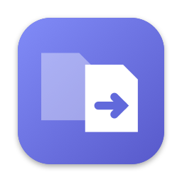
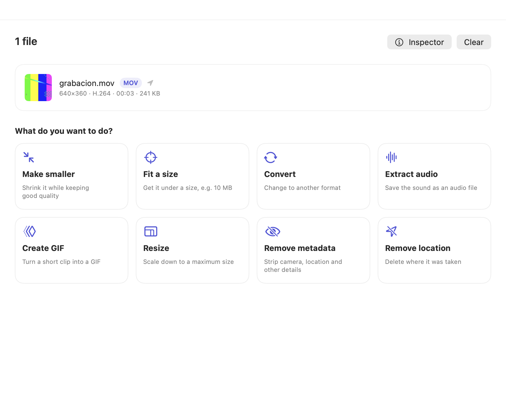
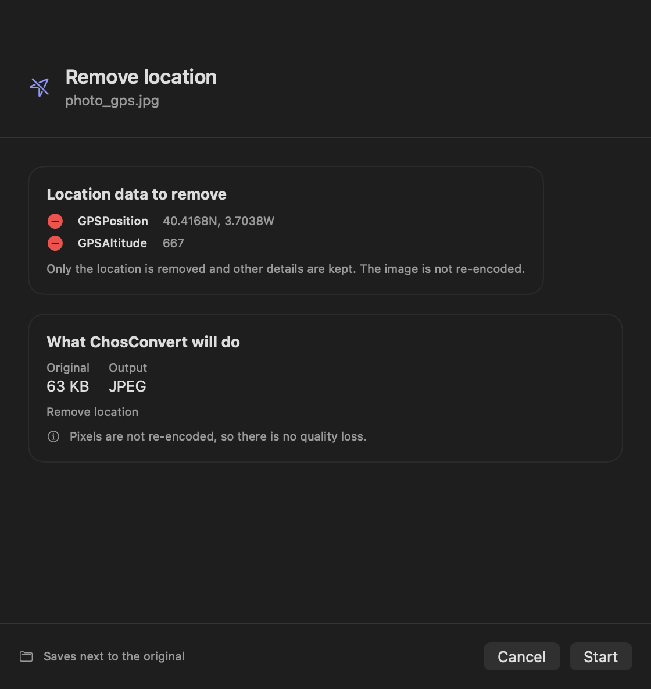

<p align="center">
  
</p>

<h1 align="center">ChosConvert</h1>
<p align="center"><b>Drop a file. Say what you want. Done — on your Mac, offline.</b></p>
<p align="center">
  
  
  
</p>

ChosConvert is a native, local-first file toolbox. Instead of asking which codec, CRF or container
you need, it asks **what you want to do** — *make it smaller*, *fit under 10 MB*, *extract the
audio*, *remove the location* — and works out the technical details. An Advanced mode exposes
codecs, encoders, bitrates and more when you want them.

| Drop anything | Intent-first actions |
| --- | --- |
|  |  |
| **Plan before you convert** | **Honest results** |
|  |  |

*Screenshots are rendered from the real views by `SnapshotRenderer` (no mock-ups).*

## What works today (v0.1, macOS)
- **Images** — JPEG, PNG, HEIC, AVIF, TIFF, BMP, GIF, **WebP** (bundled libwebp). Resize,
  web-optimize (WebP · 1920 px · sRGB · no metadata), alpha flattening, **lossless removal of GPS
  or all metadata** (orientation kept).
- **Video** — convert by **remuxing whenever possible** (no quality loss), make smaller with
  hardware HEVC/H.264 (VideoToolbox) and automatic software fallback, **target size** with
  verification and refinement, extract audio without re-encoding, GIF, metadata removal.
- **Audio** — MP3, AAC/M4A, FLAC, ALAC, Opus, WAV, AIFF; bit depth preserved.
- **Queue** — backpressure for big batches, real progress (pass/attempt/speed/ETA), cancel,
  retry, before/after sizes, reveal, drag the result into any app.
- **Safety** — content sniffing (a renamed `.exe` is never treated as a photo), damaged-file
  detection, originals never touched, atomic no-clobber output, private temp space.
- **Edge Dock** — drag files toward the screen edge from any app: a thin strip appears, hover
  for the actions that fit those files, drop to start. No window, no focus change, no extra
  permissions. Multi-monitor and Spaces aware. [Details](docs/EDGE_DOCK.md).
- **Command palette (⌘K)**, a **menu bar extra** (recent results, Edge Dock switch) and
  notifications when long conversions finish in the background.
- **English & Spanish.** Light & dark.

Coming next: PDF tools, local OCR, recipes, history, share-ready presets —
see [ROADMAP.md](ROADMAP.md).

## Privacy
Your files never leave your computer. No account, no telemetry, no network access — Release
builds are sandboxed without the network entitlement. Details: [PRIVACY.md](PRIVACY.md).

## Architecture
Native SwiftUI app over a portable **Rust core** (detection, planning, FFmpeg execution, target-size
optimizer, safe output) exposed through a small JSON-based C ABI, so the upcoming Windows (WinUI 3)
app shares the same engine logic. See [ARCHITECTURE.md](ARCHITECTURE.md) and [DECISIONS.md](DECISIONS.md).

## Build
```bash
scripts/test-macos.sh
```
Full instructions: [BUILDING.md](BUILDING.md). Release/signing: [RELEASE.md](RELEASE.md).

## Contributing & security
[CONTRIBUTING.md](CONTRIBUTING.md) · [SECURITY.md](SECURITY.md) · [CODE_OF_CONDUCT.md](CODE_OF_CONDUCT.md) ·
[THIRD_PARTY_NOTICES.md](THIRD_PARTY_NOTICES.md)
