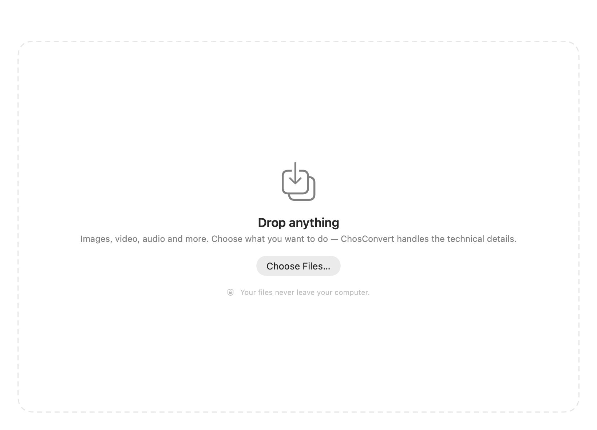
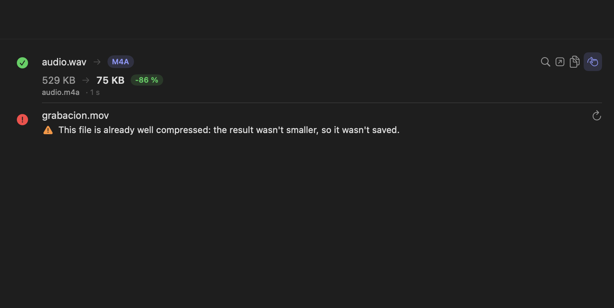

<p align="center">
  
</p>

# ChosConvert

**Convierte, comprime y prepara archivos desde tu Mac, sin conexión.**

ChosConvert es una aplicación nativa que organiza las conversiones según lo que quieres conseguir: reducir el tamaño, ajustar un vídeo a un límite, extraer el audio o eliminar la ubicación de una foto. El modo avanzado permite elegir códecs, codificadores y tasas de bits.

[Funciones](#funciones) · [Privacidad](#privacidad) · [Arquitectura](#arquitectura) · [Compilación](#compilación) · [Documentación](#documentación)

## Vista previa

| Archivos y acciones | Configuración y resultados |
| --- | --- |
|  |  |
|  |  |

Las capturas se generan con las vistas reales mediante `SnapshotRenderer`.

## Funciones

Esta entrega corresponde a la versión preliminar 0.1 para macOS.

- **Imágenes:** JPEG, PNG, HEIC, AVIF, TIFF, BMP, GIF y WebP mediante libwebp incluida. Redimensionado, optimización para web, tratamiento de transparencia y eliminación sin pérdida de GPS o metadatos, conservando la orientación.
- **Vídeo:** cambio de contenedor sin recodificar cuando es posible; compresión HEVC/H.264 con VideoToolbox y alternativa por software; tamaño objetivo con comprobación y ajuste; extracción de audio, GIF y eliminación de metadatos.
- **Audio:** MP3, AAC/M4A, FLAC, ALAC, Opus, WAV y AIFF, conservando la profundidad de bits.
- **Cola:** progreso por pasada e intento, velocidad, tiempo restante, cancelación, reintentos y comparación de tamaños. Permite mostrar el resultado en Finder o arrastrarlo a otra aplicación.
- **Protección de originales:** detección por contenido, comprobación de archivos dañados, temporales privados y escritura de salida sin sobrescribir archivos existentes.
- **Edge Dock:** acerca archivos al borde de la pantalla para mostrar acciones sin abrir la ventana principal. Compatible con varios monitores y Spaces. [Guía de Edge Dock](docs/EDGE_DOCK.md).
- **Accesos rápidos:** paleta de comandos con ⌘K, menú en la barra superior y notificaciones al terminar conversiones largas.
- **Interfaz:** español e inglés, con temas claro y oscuro.

Las herramientas PDF, OCR local, recetas, historial y nuevos ajustes predefinidos están en la [hoja de ruta](ROADMAP.md).

## Privacidad

El procesamiento se realiza en el equipo, sin cuenta ni telemetría. Las compilaciones de distribución utilizan el entorno aislado de macOS sin permiso de red. Consulta [PRIVACY.md](PRIVACY.md).

## Arquitectura

La interfaz está construida con SwiftUI. Un núcleo portable en Rust se encarga de detectar archivos, planificar conversiones, ejecutar FFmpeg, ajustar tamaños y escribir resultados de forma segura. La comunicación utiliza una interfaz C con mensajes JSON.

La futura aplicación Windows con WinUI 3 está planteada sobre el mismo motor; no equivale a una versión Windows terminada. Detalles en [ARCHITECTURE.md](ARCHITECTURE.md) y [DECISIONS.md](DECISIONS.md).

## Compilación

La aplicación está orientada a macOS 15 o posterior. Revisa las herramientas y dependencias exactas en [BUILDING.md](BUILDING.md).

```bash
scripts/test-macos.sh
```

Para empaquetado y firma, consulta [RELEASE.md](RELEASE.md).

## Documentación

- [Guía de compilación](BUILDING.md)
- [Arquitectura](ARCHITECTURE.md) y [decisiones técnicas](DECISIONS.md)
- [Hoja de ruta](ROADMAP.md)
- [Cómo contribuir](CONTRIBUTING.md)
- [Seguridad](SECURITY.md) y [código de conducta](CODE_OF_CONDUCT.md)
- [Componentes de terceros](THIRD_PARTY_NOTICES.md)
