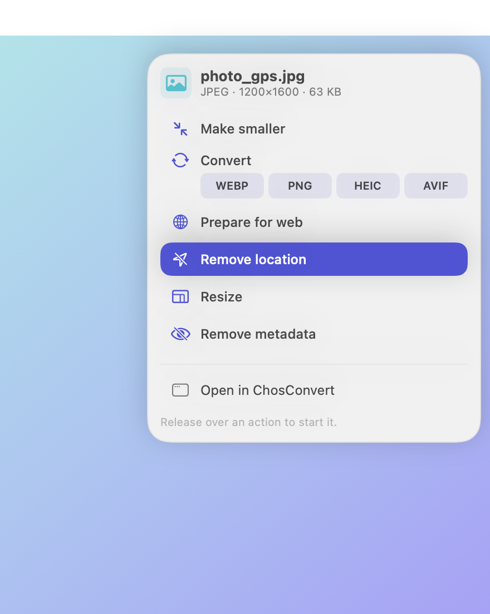
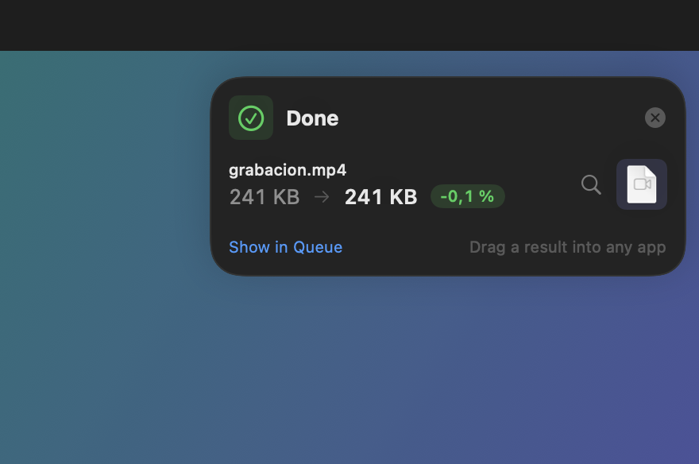
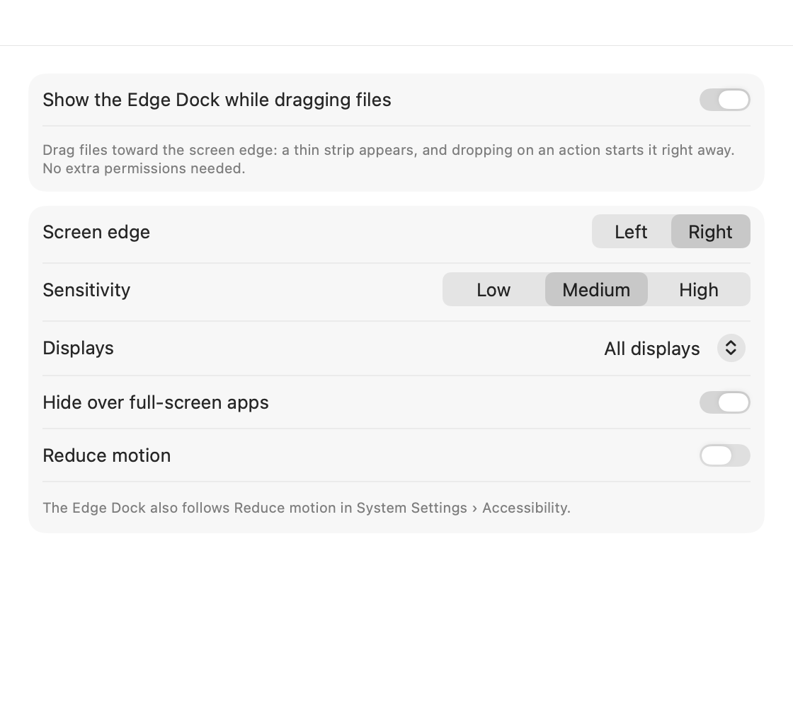

# Edge Dock (macOS)

The Edge Dock is ChosConvert's signature shortcut: start dragging files anywhere, push them
toward the screen edge, and a thin strip lights up. Hovering over it expands a panel with the
smart actions that work for *those* files; releasing over an action starts the job immediately,
shows quiet progress, and leaves the result ready to drag into another app.

| Hover (actions for a photo with GPS) | Result with drag-out | Settings |
| --- | --- | --- |
|  |  |  |

*Rendered offscreen from the real views by `SnapshotRenderer` (`CC_SNAPSHOTS=1`).*

## Requirements and how they are met

| Requirement | Design |
| --- | --- |
| Appears only during a file drag | `DragSessionWatcher` samples the mouse button and the drag pasteboard (below). Panels are ordered out the rest of the time, so the edge never blocks clicks. |
| No Accessibility permission, no global key/mouse monitors | No `addGlobalMonitorForEvents`, no `CGEventTap`. Only `NSEvent.pressedMouseButtons` (a state query) and `NSPasteboard(name: .drag).changeCount` / `.types`. Drop handling is a regular `NSDraggingDestination`. |
| Non-activating | Borderless `NSPanel` with `.nonactivatingPanel`, `becomesKeyOnlyIfNeeded`, `hidesOnDeactivate = false`. Dropping or clicking never steals focus from the source app. |
| Per display, multiple monitors | One panel per eligible display, keyed by the display UUID (`CGDisplayCreateUUIDFromDisplayID`). Rebuilt on `NSApplication.didChangeScreenParametersNotification`. |
| Mixed scaling | All geometry is in AppKit global points; each panel lives on exactly one display, so its backing scale never changes under it. |
| Spaces | `collectionBehavior = [.canJoinAllSpaces, .stationary, .ignoresCycle, .fullScreenAuxiliary]`: present on whichever Space is active on each display (with or without "Displays have separate Spaces"), unaffected by Mission Control, absent from ⌘\`. |
| Full-screen apps | Opt-out (default **on**): when a drag begins, `CGWindowListCopyWindowInfo` is checked for a normal-layer window that exactly covers a display. Only bounds/layer/owner PID are read — no window titles, so no Screen Recording permission. That display gets no strip for this drag. With the opt-out off, `.fullScreenAuxiliary` lets the strip appear over full-screen apps. |
| Works without the main window | `AppDelegate` owns `AppModel` and starts `EdgeDockController` in `applicationDidFinishLaunching`; jobs go through the same `JobQueue`. Closing the window leaves the app (and the dock) running. |
| Reduced motion | Follows *System Settings › Accessibility › Reduce motion* and the dock's own toggle: no slide/fade transitions, no strip pulse. |

## Architecture

```
DragSessionWatcher ──began/ended──▶ EdgeDockController ──▶ EdgeDockModel (@Observable state)
 (button + drag pasteboard)          │  owns one EdgeDockPanel per display        │
                                     │  frames from EdgeDockGeometry              ├─ Inspector.inspect (core detect.path …)
EdgeDockDropView (NSDraggingDestination) ─ enter/move/exit/drop ─▶ controller ─▶ ├─ actions.for_files → DockTargets rows
                                                                                  └─ AppModel.enqueue → JobQueue
EdgeDockRootView (SwiftUI) renders strip / card; reports target frames + card height back to the model
```

| File (`ChosConvertUI/EdgeDock/`) | Role |
| --- | --- |
| `DragSessionWatcher.swift` | Drag detection state machine; `DragSignals` protocol for tests |
| `EdgeDockGeometry.swift` | Pure layout: eligible screens, outer edge segments, strip/panel frames, full-screen test |
| `DockTargets.swift` | Smart actions → rows and drop targets with default intents |
| `EdgeDockModel.swift` | State: drag active, panel (screen, anchor, phase), inspection, jobs, linger timer |
| `EdgeDockController.swift` | Windows: create/position/show panels, settings and screen changes, App Nap activity |
| `EdgeDockPanel.swift` | `NSPanel` subclass, first-mouse hosting view, the single drag destination view |
| `EdgeDockViews.swift` | SwiftUI strip, card, rows/chips, job progress and results |

### Drag detection
Every 120 ms (40 ms tolerance) the watcher reads `NSEvent.pressedMouseButtons`. Only while the
primary button is down does it read the drag pasteboard's `changeCount`; if it moved since the last
button release and the pasteboard advertises `public.file-url`, a file drag has started. Releasing
the button ends it. On each release the current change count is recorded, so a drag that started
and finished between two samples is never mistaken for one on the next click. Idle cost is one
button-state query per tick and no pasteboard traffic. The pasteboard *contents* are read only by
the drag destination, after the user drags onto the dock.

While the dock is enabled the app holds a `ProcessInfo` activity
(`.userInitiatedAllowingIdleSystemSleep`) so App Nap doesn't stretch the sampling timer to seconds
when ChosConvert is in the background. Idle system sleep stays allowed. Turning the dock off ends
the activity.

### Geometry
- **Strip:** `sensitivity` sets the width (Low 3 pt, Medium 6 pt, High 12 pt). It sits on the
  display's *visible frame* edge, so if the macOS Dock is on that side the strip sits beside it and
  Dock icons stay droppable. With an auto-hiding Dock, the visible frame keeps the reveal zone free.
- **Interior edges:** an edge shared with a neighbouring display can't be "pushed against" (the
  pointer crosses into the next display), and crossing it would expand the panel by accident. The
  shared vertical range is cut out and the strip uses the longest remaining free segment
  (≥ 160 pt), or the display gets no strip on that side.
- **Panel:** 300 pt wide, up to 480 pt high, centred on the pointer's height and clamped to the
  visible frame. The window reaches all the way to the edge (the card is drawn 8 pt inside it) so
  the pointer, which entered at the edge, is still inside after expansion. Without this the panel
  would collapse at once and flicker.

### Phases
| Phase | Shown | Leaves when |
| --- | --- | --- |
| strip | thin glowing line | drag enters → `reading`; drag ends → hidden |
| `reading` | "Reading files…" | inspection finishes → `ready` / `unavailable` |
| `ready` | action rows and chips; the one under the pointer is highlighted | drop on target → `working`; drop elsewhere on the card → `held`; exit for 250 ms → strip |
| `unavailable` | reason (unsupported, too many files, needs the drop to read) + "Open in ChosConvert" | drop → `held` or open in app |
| `held` | same rows as clickable buttons | click → `working`; close (×) |
| `working` | per-file progress, then before/after sizes, reveal, drag-out handle | 8 s after the last job finishes unless the pointer is over it; × |

Hover inspection uses the same path as the main window: `Inspector.inspect` (core `detect.path`
content sniffing, then ImageIO/FFprobe/AVFoundation) with up to 24 files (folders expanded), then
`actions.for_files`. Results are cached for the drag session, so leaving and re-entering is
instant. Over 24 files, the panel offers to take them on drop instead. Unreadable files are
skipped and counted.

### Default intents (no configuration sheet)
| Action | Intent |
| --- | --- |
| Make smaller | `make_smaller(balanced)` |
| Fit a size | chips **10 MB**, **25 MB** |
| Convert | chips: up to 4 formats the planner offers, preferred first (image: WebP, JPEG, PNG, HEIC, AVIF · video: MP4, MOV, WebM, GIF · audio: MP3, M4A, WAV, FLAC) |
| Extract audio | original stream, no re-encode when possible |
| Create GIF | first 5 s (or the shortest clip), 480 px, 12 fps |
| Resize | 1920 px images · 1080p video |
| Prepare for web | `web_optimize` |
| Remove location / metadata | `remove_metadata(location / all)` |

Output location, collision policy and the hardware-encoding preference come from Settings, exactly
as in the main window. Finer control: "Open in ChosConvert".

### Sandbox
Release builds are sandboxed (ADR-0007). A file's sandbox extension may only arrive with the drop,
so hover inspection can fail with a permission error. The panel then says "Drop the files here to
see what you can do with them"; the drop moves it to `held`, re-inspects with the granted access,
and the actions become clickable. Debug builds aren't sandboxed and always inspect on hover.

### Not supported (yet)
- File promises (`NSFilePromiseReceiver`): drags from Photos or Mail attachments that don't carry
  file URLs don't arm the strip.
- Top/bottom edges (the menu bar and the macOS Dock live there).
- Windows: the Edge Dock for Windows is a Phase 5 item with its own design.

## Settings (Settings › Edge Dock, also the menu bar extra and ⌘K)
`enabled` (default on) · `side` left/right (default right) · `sensitivity` low/medium/high · `screens`
all / main / a specific display (unplugged → main) · `hide over full-screen apps` (default on) ·
`reduce motion`. Stored in `UserDefaults` under `settings.dock.*`.

## Automated tests
`EdgeDockTests.swift`: geometry with synthetic arrangements (Retina laptop + 1× external display
offset 200 pt, stacked displays, a shared edge, full-screen detection in CG coordinates); the
watcher state machine with fake signals (begin/end, non-file drags, no pasteboard reads while
idle, the fast-drag edge case); default intents; the model against the real core and engines
(hover → actions → drop → job completes in the shared queue; held → click; exit grace and cache;
unsupported and too-many-files); settings persistence. Window-server behaviour (Spaces, real
drags, full-screen Spaces) needs the manual checklist below.

## Manual test checklist (multi-monitor)
Run on a **Release** build (sandboxed) and repeat the key items on Debug. Setup: a Retina laptop
plus at least one external display at a different scale (e.g. 1× or "More space"), arranged
side by side with the external display **offset vertically**. Then once stacked vertically.

**Basics**
- [ ] Launch with the main window, close it (⌘W). Drag an image from Finder to the right edge: the
      strip appears within a fraction of a second, *only* while dragging.
- [ ] Hover the strip: the panel expands next to the pointer, lists actions for that file, and
      the row under the pointer highlights. Drop on "Convert › WebP": the result card shows
      progress, then sizes. Drag the result icon into Finder/Mail. The original is untouched.
- [ ] Focus never moves: the app you dragged from stays frontmost (menu bar unchanged).
- [ ] Release without hovering the dock: nothing appears. Leave the panel without dropping: it
      collapses back to the strip after ~¼ s and disappears when the drag ends.
- [ ] Ordinary clicks and drags of non-files (text, Safari links) never show the strip.
- [ ] Mixed batch (photo + video): "No action works for all…" plus "Open in ChosConvert".
- [ ] 30 files or a folder: "Drop them here to choose an action"; dropping opens them in the app.
- [ ] Drop on the card header (not an action): files are held; clicking an action starts it; ×
      closes. Clicking the card never takes keyboard focus from the frontmost app.
- [ ] Result card disappears ~8 s after finishing; it stays while the pointer is over it.

**Displays**
- [ ] Every display shows a strip on its *outer* right edge. The laptop's edge shared with the
      external display has no strip; moving a drag across the boundary doesn't expand anything.
- [ ] On the offset arrangement, the external display's left strip (when side = left) covers only
      the part not touching the laptop.
- [ ] Panel size and text are crisp on both the 2× and 1× displays; the panel never crosses onto
      the other display and stays within the visible area near the top and bottom.
- [ ] Settings › Displays = a specific display: only that one shows the strip. Unplug it: the
      main display takes over. Plug it back: it returns without relaunching.
- [ ] Change resolution/scale or rearrange displays while the app runs: strips follow the new
      layout on the next drag.
- [ ] macOS Dock on the right: the strip sits just left of the Dock, and dropping on Dock icons
      still works. Auto-hide Dock: the Dock still reveals.

**Spaces and full screen**
- [ ] With "Displays have separate Spaces" on and off: switch Spaces on each display; the strip
      appears on the active Space, never moves during Mission Control, never appears in ⌘\`.
- [ ] Full-screen app (e.g. Safari) on the external display, Finder on the laptop: with "Hide over
      full-screen apps" on, dragging shows no strip on the full-screen display but shows it on the
      laptop. Turn it off: the strip appears over the full-screen app and the drop works.
- [ ] Drag from a full-screen app to the edge of another display: works.

**Settings and accessibility**
- [ ] Side left/right, sensitivity low/medium/high apply on the next drag without relaunching.
- [ ] Turn the dock off from the menu bar extra and from ⌘K: no strip; Activity Monitor shows no
      App Nap prevention for ChosConvert. Turn it back on: works again.
- [ ] Reduce motion (system or dock toggle): no slide/fade, no strip pulse.
- [ ] Light/dark and Increase Contrast: the strip, card, highlights and text stay legible.
- [ ] VoiceOver: the panel and targets announce their names (drag-and-drop itself remains a
      pointer interaction; the main window offers the same actions by keyboard).
- [ ] Spanish (System Settings › Language & Region › Applications › ChosConvert › Español): all
      dock text is translated.

**Sandbox (Release)**
- [ ] Drag a file from a folder ChosConvert has never accessed: if hovering says "Drop the files
      here…", dropping shows the actions and they work.
- [ ] Energy: with the dock enabled and the app idle in the background for 10 minutes, Activity
      Monitor's Energy Impact stays near zero.
